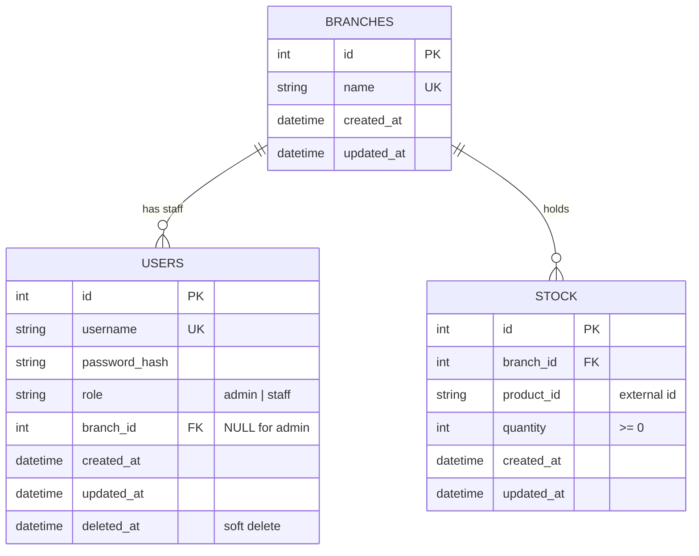

# HBntory - Database Schema (Backoffice)

SQLite database managed with SQLAlchemy. Three tables: `branches`,
`users`, `stock`. Product details (name, price, description...) are
**not** stored: they stay in the external Product API.

## Diagram

## Tables

### `branches`

| Column | Type | Notes |
|--------|------|-------|
| `id` | integer | primary key |
| `name` | string(100) | unique |
| `created_at`, `updated_at` | datetime | set automatically |

### `users`

| Column | Type | Notes |
|--------|------|-------|
| `id` | integer | primary key |
| `username` | string(50) | unique |
| `password_hash` | string(255) | PBKDF2-SHA256 hash, never the password |
| `role` | string(10) | `admin` or `staff` |
| `branch_id` | integer, nullable | FK -> `branches.id` |
| `created_at`, `updated_at` | datetime | set automatically |
| `deleted_at` | datetime, nullable | soft delete: `NULL` = active |

### `stock`

| Column | Type | Notes |
|--------|------|-------|
| `id` | integer | primary key |
| `branch_id` | integer | FK -> `branches.id`, required |
| `product_id` | string(50) | id of the product in the external Product API |
| `quantity` | integer | `CHECK (quantity >= 0)` |
| `created_at`, `updated_at` | datetime | set automatically |

`UNIQUE (branch_id, product_id)`: one stock line per product per branch.

## How the rules are enforced

| Rule | How |
|------|-----|
| A common user belongs to exactly one branch | `users.branch_id` is a single FK (so at most one branch) and `CHECK (role = 'staff' AND branch_id IS NOT NULL)` (so at least one) |
| The admin is not assigned stock management | `CHECK (role = 'admin' AND branch_id IS NULL)`: stock belongs to a branch, and the admin has none |
| Stock is linked to a branch and an external product id | `stock.branch_id` (FK, required) + `stock.product_id` (external id), unique together |
| Product details are not stored locally | no products table: only `product_id`; details are read from the Product API when needed |
| Deleted users are soft-deleted | `deleted_at` is set by `User.soft_delete()`; the row is never removed, so its history stays consistent |

Both role rules are one database constraint, `ck_users_branch_by_role`:
`(role = 'admin' AND branch_id IS NULL) OR (role = 'staff' AND branch_id IS NOT NULL)`.

## Why no other tables

- **No `products` table:** product data belongs to the Product API;
  copying it would create two versions that can disagree.
- **No `stock_movements` table yet:** no requirement of this task needs a
  history. It can be added later if a history page is built.
- **No `roles` table:** two fixed roles are enough; a `CHECK` constraint
  keeps the value valid.

## Initial data

`scripts/init_db.py` creates the tables and inserts:

- one `admin` user (no branch);
- two branches: Paris and Lyon;
- one staff user per branch (`paris_staff`, `lyon_staff`);
- sample stock: 3 products per branch.

Passwords are read from `ADMIN_PASSWORD` and `STAFF_PASSWORD` (`.env`).
If they are missing, the script generates random ones and prints them
once. Only their hashes are stored. The script can run several times
without duplicating data.

    python3 scripts/init_db.py

The sample `product_id` values (`1` to `4`) must exist in the Product
API; adjust `SAMPLE_STOCK` in the script if the API uses other ids.

## Validation rules

| Rule | Where | How |
|------|-------|-----|
| Quantity cannot become negative | service + database | `remove_stock` refuses to remove more than available; `CHECK (quantity >= 0)` as a safety net |
| Stock changes need a positive integer | service | `check_quantity`: must be an `int` (not `bool`, not `2.5`) and `> 0` |
| Operations reference a valid branch | service + database | `get_branch` raises a clear error; the FK refuses unknown branches |
| Product id exists in the Product API | service | `add_stock` calls `product_exists` (`GET /products/{id}`: 200 = exists, 404 = not) |

### Why validation lives in the service layer (`app/stock_service.py`)

- **One place for every stock change.** The Backoffice, and later the
  Inventory API, call `add_stock` / `remove_stock`; no route can skip
  the checks.
- **Clear error messages.** A `StockError` says what is wrong ("Stock
  insuffisant : 3 disponible(s), 5 demandé(s)."), which a raw database
  error does not.
- **The Product API check needs Python.** A database constraint cannot
  call an HTTP API.
- **The database constraints are a second safety net.** If a bug ever
  bypasses the service, the `CHECK` and foreign keys still refuse
  invalid data.

### Product API check: when it applies

- Checked when stock is **added** (a new product can enter a branch).
- Not checked when stock is **removed**: the product is already in our
  stock, and a temporary Product API outage should not block a sale.
- If the Product API is unreachable, `add_stock` raises
  `ProductAPIError`: the operation is refused rather than accepting an
  id we cannot verify.
